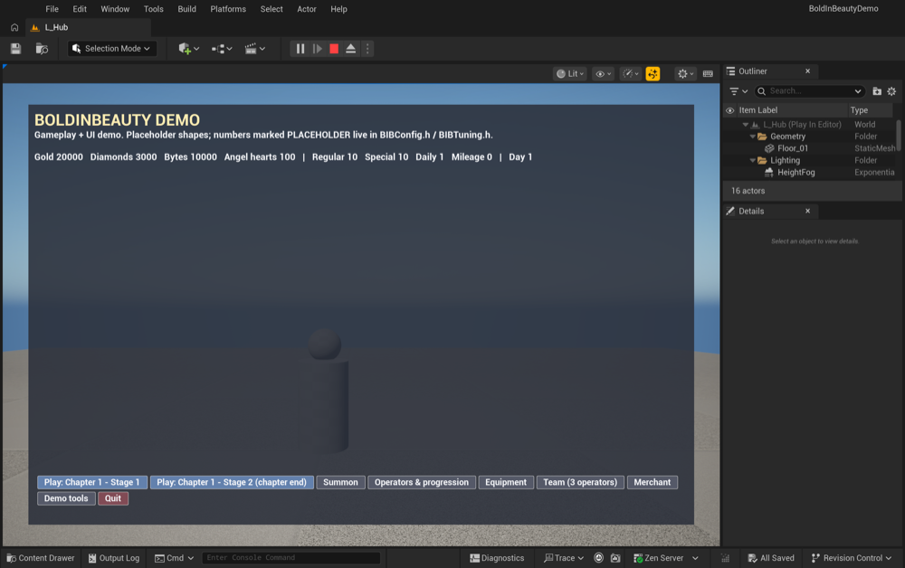
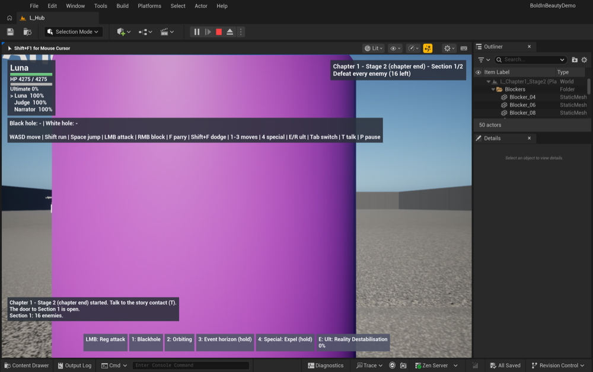
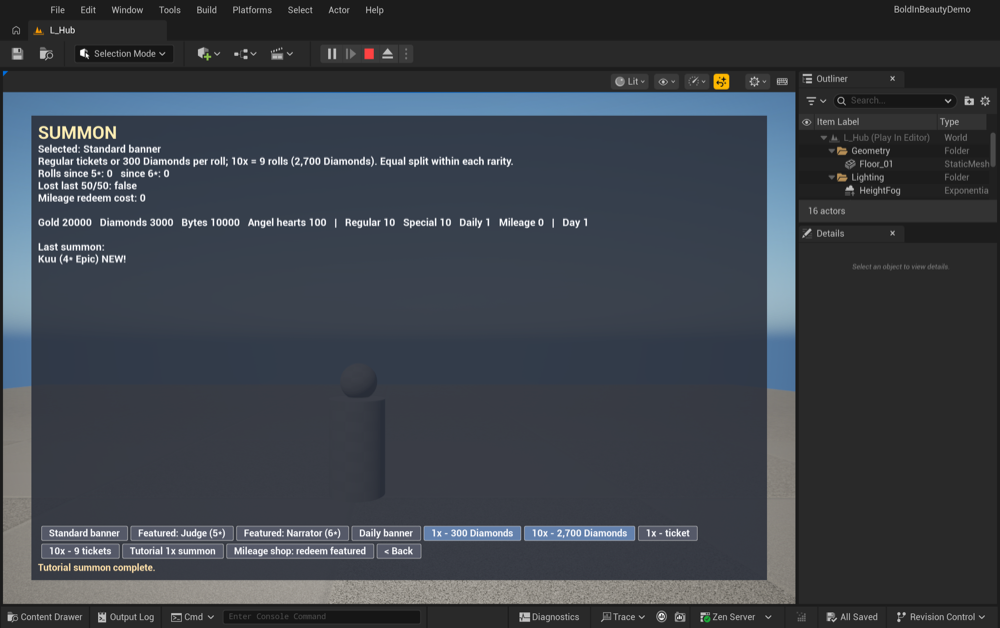
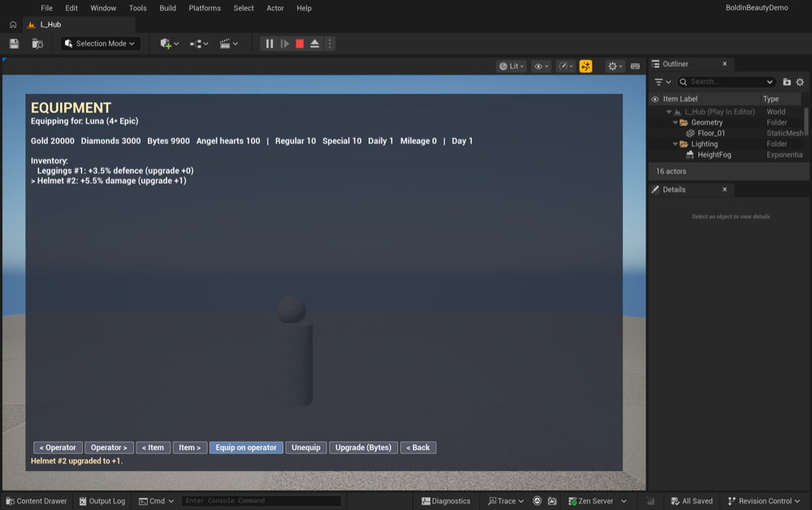
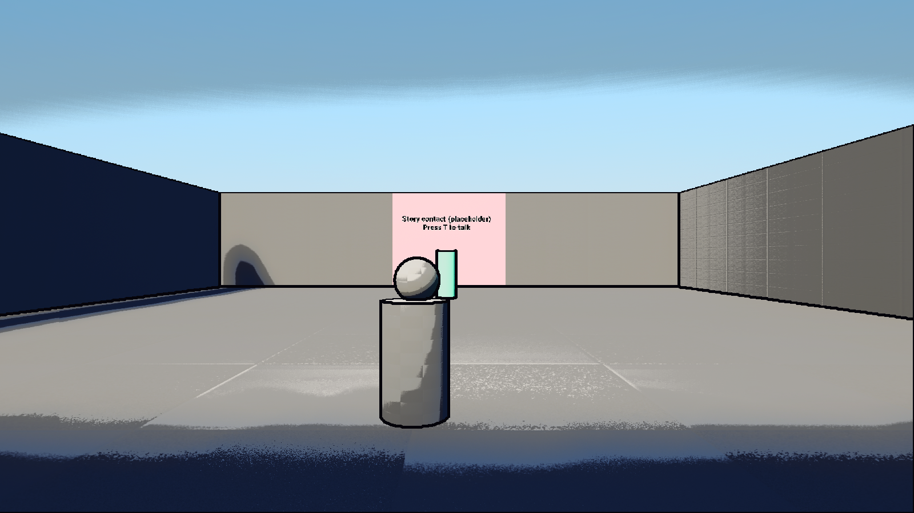
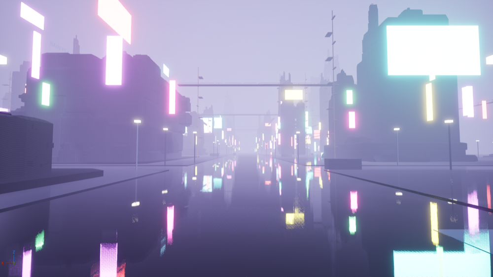

# Boldinbeauty

A 3D gacha game set in cyberpunk Neo Tokyo, 2009. Players are commanders. The fighters they recruit are operators: twenty characters across four rarities, with a standard banner, a featured banner, a daily banner, pity, and a mileage shop.

**by GreyHat Inc**

This repository is the public snapshot of the Unreal Engine 5.8 demo: gameplay code, the account server, the asset catalogue, and the AI production scripts. It is a development tree, not a finished store build.

## What you are looking at

- **Demo** (`Demo/BoldInBeautyDemo`) — C++ game module, UI, campaign, combat, summoning, and a small Node account service.
- **Design record** (`BoldInBeauty_MAIN`) — the shared rules for rates, operators, combat, and the world.
- **Asset catalogue** (`docs/Assets`) — the list of characters, props, and sets prepared for 3D generation.
- **Website** (`website`) — a static roster page. Open `website/index.html`.

Guest play does not need the account server. Creating an account does.

## AI pipeline

GreyHat Inc builds Boldinbeauty with AI at each step. People set the creative direction. Models and scripts do the production work.

1. **Rules and systems.** The design record is the source for rates, kits, and the campaign. Coding agents implement those rules as Unreal C++ and as checked headless tests.
2. **Characters and sets.** Concepts are turned into turnaround images, then into game meshes with Tripo (image and multi-view to 3D). The prompts, triangle budgets, and chapter assignments live in `docs/Assets`.
3. **UI motion.** Menu transitions, combat callouts, and ads are HTML timelines animated with GSAP (`Demo/BoldInBeautyDemo/Art/MotionPack`). A script renders them into atlases the game can play.
4. **Weather and audio.** Rain, wind, and thunder are built in the editor by `Tools/build_weather.sh`. The loops are synthesized in the repo. There is no third-party sound library.
5. **Levels.** `Tools/build_greybox.sh` can assemble Neo Tokyo and the Ark inside the editor. That step needs two Fab city kits installed locally. Those kits are not in this snapshot. An optional Elite Bundle dressing pass is the same: bring your own licensed packs, then run the importer.
6. **Portraits and the site.** Operator portraits on the website and in the UI are generated images checked into this tree.

## Screenshots

Main menu, combat, summoning, and equipment from the demo:

| Menu | Combat |
| --- | --- |
|  |  |

| Summon | Equipment |
| --- | --- |
|  |  |

A chapter fight and a Neo Tokyo blockout:





More captures that fit this snapshot are in `reports/demo/screenshots/`. Larger render passes were left out so the archive stays small. See `PUBLIC_AUDIT.md`.

## How to build

You need **Unreal Engine 5.8**. The project file is `Demo/BoldInBeautyDemo/BoldInBeautyDemo.uproject`.

### Play in the editor

1. Install Unreal Engine 5.8 and, on Windows, Visual Studio 2022 with the Game development with C++ workload. On macOS, install Xcode.
2. Open `BoldInBeautyDemo.uproject` and let the editor compile the `BoldInBeautyDemo` module.
3. Press Play. The boot map is the hub. Without a hosted server, choose **Play offline as a guest**.

Controls and the demo's systems are documented in `Demo/BoldInBeautyDemo/README.md`.

### Windows package

From `Demo/BoldInBeautyDemo`:

```powershell
powershell -ExecutionPolicy Bypass -File Tools\Package-Windows.ps1
```

Details, tester notes, and the smoke test are in `docs/windows-build.md`.

### macOS package

From `Demo/BoldInBeautyDemo`, with Engine 5.8 available to the script:

```sh
Tools/package_mac.sh [output-dir] [path/to/UE_5.8]
```

Build the local greybox maps first if you want them in the package (`Tools/build_greybox.sh`). That script imports Fab kits from your own vault cache. This snapshot does not include those kits.

### Account server

Codes are printed to the log if you run the in-memory server:

```sh
cd Demo/BoldInBeautyDemo/Server
npm install
npm run dev
```

The game expects it at `http://127.0.0.1:8080`. Set `ADMIN_EMAILS` to the mailbox that should receive the admin profile. The sample value in this public tree is `admin@example.com`. Do not commit a real `.env`. See `Demo/BoldInBeautyDemo/Server/README.md` and `docs/hosting.md`.

### Tests without the editor

The server tests run on Node 20.19 or newer (`npm test` in `Demo/BoldInBeautyDemo/Server`). Gameplay checks that do not need the editor are under `Demo/BoldInBeautyDemo/Tests`.

## What is not in this snapshot

Purchased Fab and Elite Bundle packs are not redistributed. Rebuild steps that need them are documented with the tools, and they no-op or warn until you supply the packs you own. `PUBLIC_AUDIT.md` lists every pack and every file left out of this archive.

## License

Game code and documents in this snapshot are published by GreyHat Inc for the public Boldinbeauty project. Third-party pieces keep their own terms: SIL Open Font License fonts, and GSAP under the GreenSock standard license (`https://gsap.com/standard-license`). Marketplace packs named in the audit are not included.
